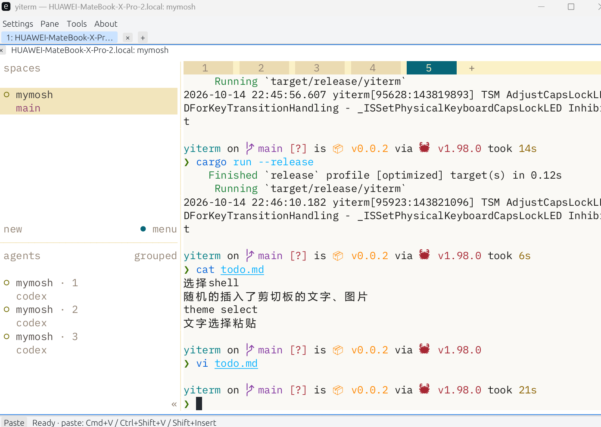
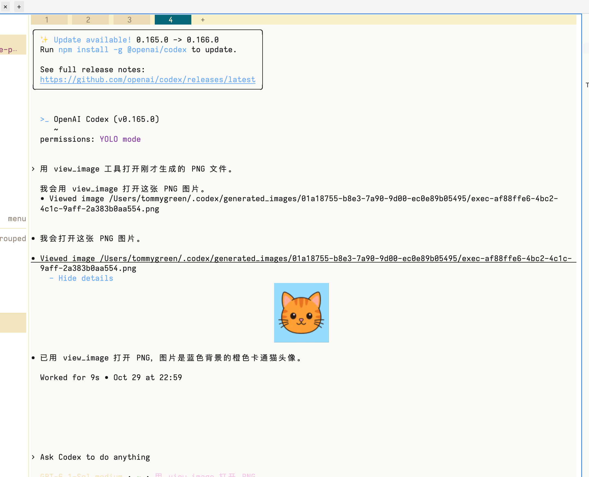
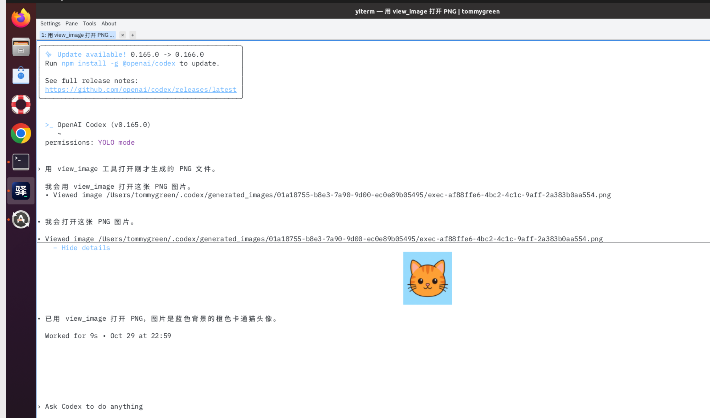
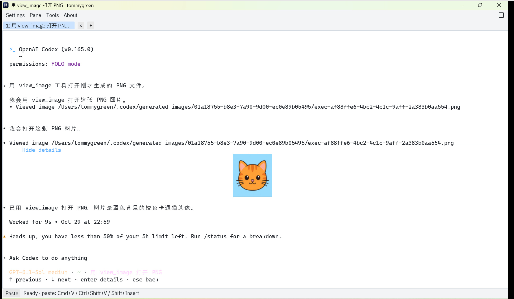

# YiTerm

[English](readme.md) | 简体中文

轻量原生终端，支持 macOS、Windows 和 Linux。

## 下载运行

从 [Releases](https://github.com/wynemo/yiterm/releases) 下载对应平台的压缩包并解压，无需安装 Rust。

- **macOS（Apple Silicon）**：下载 `macos-arm64.tar.gz`，解压后打开 `YiTerm.app`，也可在解压目录中运行 `./yiterm`。
- **Windows 10 / 11（x64）**：下载 `windows-x64.zip`，双击 `yiterm.exe`。请将 `conpty.dll` 和 `OpenConsole.exe` 保留在同一目录。
- **Linux（x64）**：下载并解压 `linux-x64.tar.gz`，首次运行 `bash ./install-desktop.sh`，之后从应用菜单点击 YiTerm 启动；也可运行 `./yiterm`。最低要求 glibc 2.17，需要 X11 和可用的 OpenGL 驱动。详细要求见 [Linux 使用说明](TECHNICAL.md#linux-x64--centos-78)。

## 功能

- 多标签页，每个标签页运行独立会话。
- 左右、上下分栏，可拖动调整大小。
- 本地 shell、SSH 远端会话和 Windows 内置 Mosh 客户端。
- 跟随终端目录的文件浏览器，以及支持 diff、暂存和提交的 Git 侧栏。
- Windows 内置 WebView2 浏览器可复用当前聚焦分栏的 YiTerm SSH 连接。
- 拖动选择文字并复制。
- 粘贴文字和图片；图片保存为文件并输入路径，SSH 会话支持上传到远端。
- Windows / macOS / Linux 本地终端和 SSH 会话支持通过 Kitty 图片协议显示静态图片，Windows 使用内置 SSH 客户端。
- 内置等宽字体，无需额外安装。

Windows、macOS 和 Linux 均支持在终端内直接显示图片。

构建、快捷键、配置和日志等详情见 [技术与详细使用说明](TECHNICAL.md)。
